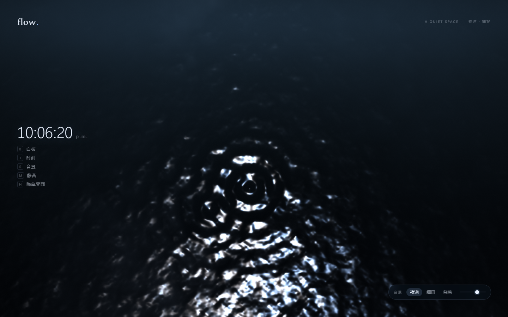
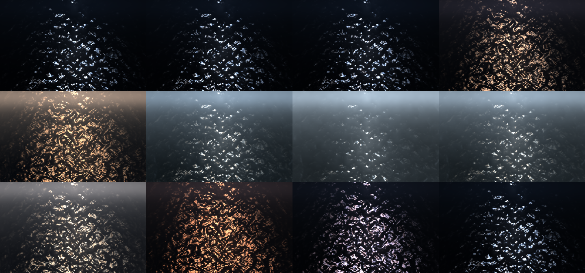
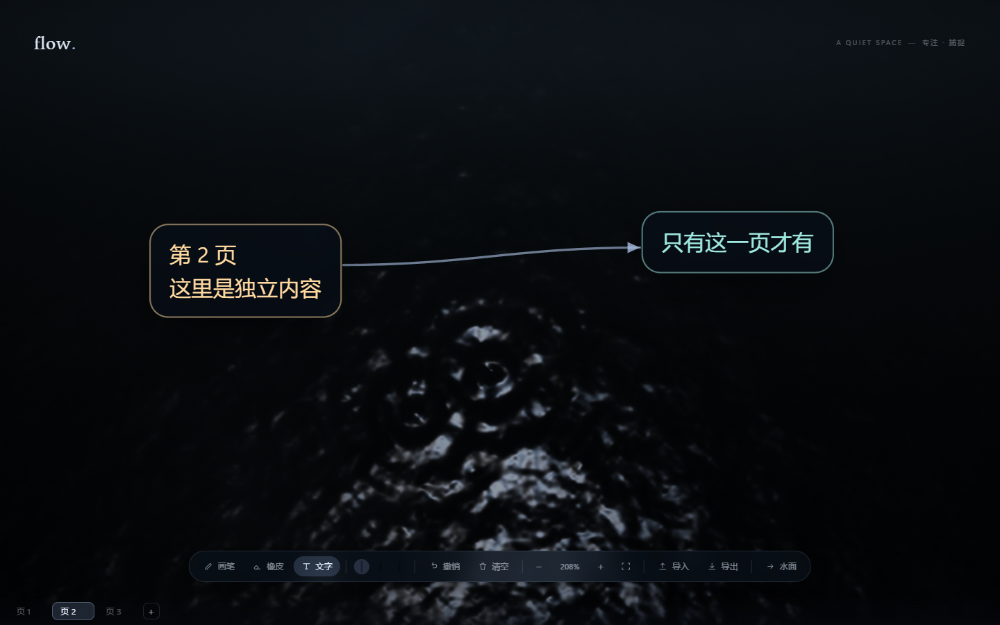
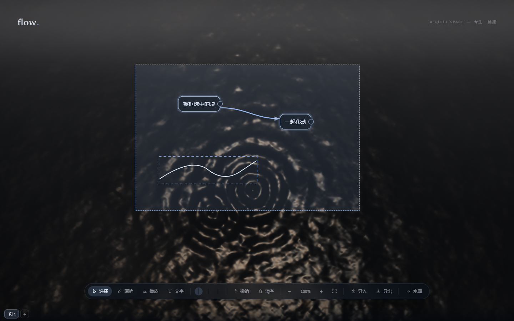

# flow — 一池水，一点声音，一块白板

> ### 🔗 在线访问 → **<https://forbitliang.github.io/webflow/>**
>
> 托管在 GitHub Pages。手机也能开，但触摸端没有 hover，涟漪要拖动才出。

一个可以长期挂着的网页：背景是程序化生成的湖面，鼠标划过会泛起涟漪；播放程序化合成的环境音；按一个键就能切到白板，写字、摆字块、连线。**湖面会跟着一天的光走——白天是银白的湖，傍晚转暖变暗，夜里沉成深蓝。** 零依赖 · 零构建 · 零外部资源 · 无版权风险。







---

## 快速开始

**方式一：直接打开线上版** —— <https://forbitliang.github.io/webflow/>

**方式二：本地双击 `index.html`** —— 用的是传统 `<script>`（非 ES module），`file://` 下也能跑。快速看一眼足够了；但浏览器的 `file://` 存储策略可能让白板内容无法跨刷新保存，要持久化就用下面两种方式。

**方式三：一键启动本地服务**（行为和线上一致，白板内容能正常保存）

```powershell
# 在 project/flow 目录下，右键「启动预览.ps1」→ 使用 PowerShell 运行
# 或者：
powershell -ExecutionPolicy Bypass -File "启动预览.ps1"
```

脚本会起服务并自动打开浏览器，**关掉那个窗口就停止**。等价的手工命令：

```powershell
python -m http.server 8848
# 打开 http://127.0.0.1:8848/
```

---

## 操作

### 通用

| 按键 | 说明 |
|---|---|
| 移动鼠标 | 水面泛起涟漪，并触发水声 |
| **上下拖动「湖面时间」拨码**（屏幕最右端竖条） | 把湖面拨到一天里的任意时刻（白天银白 / 傍晚暖暗 / 夜里深蓝） |
| **点「自动」** | 让湖面跟着**当前真实时间**走（默认就是自动） |
| `B` | 水面 ⇄ 白板 |
| `Esc` | 取消选中 → 结束编辑 → 回到水面（按这个优先级逐级退） |
| `T` | 显示 / 隐藏时间（时钟和拨码一起收起） |
| `S` | 循环切换音景（夜湖 → 细雨 → 鸟鸣） |
| `M` | 静音 |
| `H` | 隐藏 / 显示界面；水面下 24 秒无操作也会自动隐藏（挂机模式） |

### 湖面时间

屏幕**最右端**竖着一支时间拨码（像温度计），垂直居中：**上端是凌晨、中间是正午、下端是深夜**，轨道本身就是一条夜→昼→夜的渐变，刻度 0/6/12/18/24 贴在轨道右侧，底部显示当前时刻和时段名。时钟和快捷键在屏幕左侧。

用 `position: fixed` 定位在 `right: var(--pad)`，所以它脱离 `#ui` 的纵向 flex 流，不会把顶部/底部两行挤开；同时它仍然挂在 `#ui` 里，因此「隐藏界面」（`H`）和「白板模式」的隐藏规则照样管用。

- **默认自动**：跟着系统时间走。早上打开是清晨的湖，中午银白，傍晚转暖，夜里深蓝。变化连续，不会跳
- **上下拖动拨码**：立刻切到手动，湖面平滑过渡到你拨到的时刻。过渡走 24 小时圆环的**最短路径**，所以从 23:50 拨到 00:10 只挪 20 分钟，不会倒着扫过一整天
- **点「自动」**：切回跟随真实时间
- 手动设定的时刻会记住，下次打开还在；点「自动」就恢复跟随

竖滑条的实现：原生 `<input type="range">` 只能横着，所以把它 `rotate(90deg)`，容器尺寸按旋转后的实际占位给（24px 宽 × 轨道长）。旋转后"横向的左→右"变成"纵向的上→下"，所以那条夜→昼→夜的横向渐变正好呈现为顶部凌晨、底部深夜。刻度则和轨道排在同一行 flex 里（不是绝对定位），这样面板宽度会自动算上它，不会溢出玻璃面板。

白板模式下不显示时间（写字时不需要）。

### 白板 · 工具

**每次进入白板都以「文字」工具开场**（记想法是这个白板的主要用途），要画画就按 `P`。

| 按键 | 说明 |
|---|---|
| **`1` `2` `3` `4`** | **选择 / 画笔 / 橡皮 / 文字**（最顺手的四个键） |
| `V` / `P` / `E` / `X` | 同上，另一组别名 |
| `Shift+1` `Shift+2` `Shift+3` | 颜色（水光白 / 暖月黄 / 冷青），同时作用于笔迹和选中的字块 |
| 连点两次「画笔」 | 循环切换笔宽（细 / 中 / 粗） |
| `U` 或 `Ctrl+Z` | 撤销（先撤字块/连线，再撤笔迹） |
| `Delete` / `Backspace` | 删除选中的内容 |
| `Ctrl+A` | 全选当前页 |

> 数字键读的是 `e.code` 而不是 `e.key`：`Shift+1` 的 `e.key` 是 `"!"`，用 `e.key` 根本匹配不到数字。小键盘（`Numpad1~4`）也一起支持。

### 白板 · 框选与整组移动



按 `V` 切到**选择**工具，就可以像任何白板应用那样批量操作了：

| 操作 | 说明 |
|---|---|
| 在空白处**拖拽** | 拉出框选矩形，**碰到就选中**（字块 / 连线 / 笔迹三类一起选） |
| `Shift` + 拖拽 | 在已有选区上**追加** |
| `Shift` + 点某个对象 | 把它加入 / 移出选区 |
| 点空白处 | 取消选中 |
| **拖动任意一个选中项** | 整个选区一起移动（相对位置保持不变） |
| `Ctrl+A` | 全选 |
| `Delete` | 删除全部选中（**可撤销**） |

三类对象的实现方式不同，所以命中判定也不一样：

| 对象 | 选中判定 | 移动方式 |
|---|---|---|
| 字块（DOM） | 元素矩形与框选矩形相交 | 改 `left/top` |
| 连线（SVG） | 曲线包围盒相交；单点命中用「点到贝塞尔的距离」 | 跟着两端的字块自动重排 |
| 笔迹（Canvas） | 笔迹包围盒相交；单点命中用「点到折线的距离」 | 平移所有采样点 |

选中的笔迹会在 Canvas 上画虚线包围框（借用了「正在画的那一笔」那一层，选择工具下它是空闲的）。

> 选择工具下**画布不会落笔**——否则"拖拽"就同时意味着"框选"和"画画"了，两者会打架。

### 白板 · 分页（像 Excel 的 sheet）

窗口最底部是分页标签栏，白板模式下才会出现。

| 操作 | 说明 |
|---|---|
| 点标签 | 切到那一页 |
| 点 `+` | 新建一页（名字默认「页 N」） |
| **双击标签** | 改名（回车确认，Esc 取消，最长 24 字） |
| 标签上的 `×` | 删除这一页（会先确认；只剩一页时不允许删） |
| `Ctrl+PageDown` | 下一页；已经是最后一页时新建一页 |
| `Ctrl+PageUp` | 上一页 |

每页有**独立的笔迹、字块、连线和撤销栈**。切页不会串内容，撤销也不会跨页删到别人的东西。缩放和平移是全局共享的（不按页记忆）。
### 白板 · 缩放与平移

| 操作 | 说明 |
|---|---|
| 滚轮（或触控板捏合） | 以鼠标位置为锚点缩放，25% ~ 500% |
| `+` / `−` | 以屏幕中心缩放 |
| `0` | 重置为 100% |
| 空格 + 拖动 | 平移 |
| 中键拖动 | 平移 |
| 工具条的 ⤢ | 缩放到刚好装下全部内容 |

工具条中间的百分比就是当前缩放，点它等于重置。

### 白板 · 字块与连线

- **新建**：按 `X` 切到文字工具后点空白处；或直接点工具条「文字」，会在视图中央给一个块并进入编辑。**任意缩放比例下，点视口里任何空白处都会新建**，不会突然变成画笔
- **打字**：双击字块进入编辑。块会**随文字自动伸缩**（最宽 320px 后换行）。`Esc` 或点别处结束编辑；空块不会留下
- **移动**：直接拖动字块
- **连线**：鼠标移到字块上，右侧出现小圆点，**从圆点拖到另一个字块上**即可建立带箭头的连线。连线跟着块自动重排
- **删除**：点选字块或连线后按 `Delete`

白板内容（**所有页**的笔迹 + 字块 + 连线）自动保存在浏览器本地，下次打开还在。

### 导入 / 导出

| 工具条按钮 | 说明 |
|---|---|
| **导入** | 收 `.json` 工程文件与 `.excalidraw`，**也可以直接把文件拖进窗口** |
| **导出** | 弹出菜单，三种格式 |

导出菜单里三项：

| 格式 | 内容 |
|---|---|
| **PNG 图片** | 当前页 · 2 倍分辨率 · 深色底。**按内容范围出图**，与缩放平移无关 |
| **.excalidraw** | 当前页 · ⚠️ 实验性 · 可拖进 Obsidian 的 Excalidraw 插件 |
| **工程文件 .json** | **含全部页** · 可再导入 · 无损 |

`Esc` 或点菜单外面即可收起菜单。

导入的行为按文件类型区分：

| 文件 | 行为 |
|---|---|
| `.excalidraw` | **新开一页**放进去，页名取文件名。不动现有内容，所以不用确认 |
| `.json` 工程文件 | **整体替换所有页**（会先弹确认，并告诉你将导入几页几笔） |

关于 `.excalidraw`：

- **导出**：笔迹 → freedraw，字块 → 矩形 + 文字（含容器绑定），连线 → 箭头（含两端绑定）
- **导入**：freedraw → 笔迹；rectangle / ellipse / diamond / 独立 text → 字块；绑定的文字填回容器；arrow → 连线。连线的两端**优先用绑定信息解析，没有绑定就退回几何就近匹配**（所以手画的箭头也能认出来），实在认不出的会跳过并在提示里告诉你跳了几条
- 已知损失：Excalidraw 的数据模型里没有「橡皮擦笔迹」，所以**擦除结果不保留**。要完整还原就用工程文件或 PNG

> 「清空」只清**当前页**，其他页不受影响。

---

## 目录结构

```
flow/
├── index.html          页面骨架
├── css/style.css       全部样式
├── js/
│   ├── camera.js       白板视图相机（缩放 / 平移）
│   ├── geom.js         纯几何：包围盒 / 相交 / 点到线段与贝塞尔的距离
│   ├── sun.js          一天之内的湖面光照调色板
│   ├── water.js        WebGL 程序化水景（含 Canvas 2D 降级）
│   ├── audio.js        Web Audio 程序化音景
│   ├── camera.js       白板视图相机（缩放 / 平移）
│   ├── board.js        笔迹白板（双层画布）
│   ├── blocks.js       文字块与连线（DOM + SVG）
│   ├── store.js        多页持久化、包围盒、导入导出
│   └── app.js          编排层：状态机 / 分页 / 快捷键 / 时钟 / 工具
├── tools/
│   ├── preview.js      着色器的 CPU 等价实现，离线渲染调参
│   ├── selftest.js     纯逻辑自检（180 项）
│   └── check-globals.js 源码级检查：裸调用 api-only 函数
├── docs/               预览截图
├── 启动预览.ps1         本地起服务并打开浏览器
└── 发布到GitHub.ps1     一键发布到 GitHub Pages
```

## 原理（七块）

**水景** —— 不是「用代码画了一个湖」，而是：一个高度场（低频涌浪 + 中尺度风纹 + 细碎纹理 + 鼠标激起的解析涟漪环）→ 用有限差分求法线 → 用 Blinn-Phong 算月光镜面高光。关键点：

- 涟漪是**解析环**而非 FBO 波场模拟：每个水滴存 (位置, 出生时间, 强度)，在着色器里直接算 `sin(相位)` 环，省掉 ping-pong 渲染目标，代码量和故障面都小一个数量级。
- 月光带的形状靠**各向异性法线**（把法线的水平分量压扁到 0.5）：掠射视角下光斑横向拉长，这才是真实月光带的成因。
- 光路宽度随屏幕高度变化（近处宽、远处窄），是锥形而非等宽条。
- R/B 通道用略微偏移的光向 → 涟漪边缘出现色散彩边。
- 涟漪裁剪半径处乘了 `smoothstep` 窗口函数，否则会留下一圈可见的硬边。

**音景** —— 全部由 Web Audio 实时合成，无音频文件：

| 音景 | 构成 |
|---|---|
| 夜湖 | 布朗噪声过低通当涌浪 + 白噪声过带通当拍岸（左右两路不同相位 LFO 制造立体声宽度） |
| 细雨 | 上面基础上加高通"雨丝"层，再按泊松式随机间隔撒短促的滤波噪声当作雨点 |
| 鸟鸣 | 底噪更轻更亮（像树梢的风）+ 稀疏鸟叫：每声是 2~4 个快速上滑的正弦音，音高按"每只鸟"整组随机；约 1/4 概率变成 5~8 声的快速颤音 |

鼠标激起的「水滴」声是一个快速下滑的正弦加一小撮噪声瞬态，按鼠标 X 坐标做声像。

**湖面光照（一天之内）** —— 时间不直接写进着色器，而是先由 `js/sun.js` 把「几点钟」映射成一组完整的光照参数，再作为 uniform 喂进去。着色器里**没有任何写死的颜色**。

`sun.js` 里是一张 11 个关键帧的表（深夜 / 夜末 / 破晓 / 日出 / 上午 / 正午 / 午后 / 斜阳 / 傍晚 / 暮色 / 入夜），每帧给出一整套参数，中间线性插值：

| 参数 | 作用 |
|---|---|
| `deep` `mid` `sky` | 水体由深到浅的三档底色 |
| `light` | 光源颜色（夜里偏冷白，日出日落偏暖橙） |
| `elev` | 光源**仰角**：决定光柱的长短宽窄（正午高而短，日出日落贴着地平线拉出长金光带） |
| `glint` `sheen` | 镜面碎光 / 宽柔光的强度 |
| `amb` | 天光反射强度，直接决定水面"亮不亮" |
| `vig` `far` `path` | 暗角下限 / 远处亮带 / 光柱宽窄 |

这么做的好处是**这段逻辑可以被单元测试覆盖**：白天比傍晚亮、傍晚比深夜亮、色温冷暖、光源仰角、24 小时首尾相接不跳变、细步长下无阶跃……都在 `selftest.js` 里断言过。不然「一天 24 小时的观感」根本没法靠肉眼逐个检查。

两个踩过的坑，也都固化成了断言或注释：

- **底色过亮会把水纹对比度压掉**，整片糊成雾。白天的"白"要靠「中等色调的水体 + 强烈的日光碎点」，不是把底色拉到接近 1。
- **白天不该把光柱收窄**。一开始我让正午 `path` 变大（收窄），结果日光碎光缩成一条细线，画面很平。实际上正午的日光眩光是**铺开**的。

调色板只有这一处真源，`tools/preview.js` 也是读它，所以改一个数字，离线预览和线上会一起变。

**笔迹白板** —— 双层画布：`#board` 存已完成的笔迹，`#board-live` 只画正在画的那一笔。这样实时预览可以用完整的中点二次曲线平滑重绘，落笔后又与最终结果完全一致。橡皮直接作用在 base 层（`destination-out`），因此擦除结果可撤销、可导出。

**字块与连线** —— 字块是 DOM 元素（所以能直接打字、能用浏览器原生的文字选择与输入法），连线是 SVG 贝塞尔曲线：

- 字块用绝对定位 + `translate(-50%,-50%)`，模型里存的是**中心点**，宽高从 DOM 实测（因为随文字自动伸缩）
- 连线锚点由两个块的**中心连线与矩形边界求交**得到，方向决定贝塞尔控制点偏移，所以从哪一侧连出都自然
- 连线被拆成两条路径：一条透明的 16px 粗"命中路径"用来点选，一条可见路径负责显示
- 打字的按键会在块内被 `stopPropagation` 拦下，所以 `B`/`H`/`T`/`S` 这些全局快捷键不会在你打字时误触发

**相机** —— 缩放平移由**同一个相机对象**驱动三层，这是三层能永远对齐的原因：

| 层 | 变换方式 |
|---|---|
| 笔迹画布 | `ctx.setTransform(dpr*s, 0, 0, dpr*s, dpr*tx, dpr*ty)`，笔迹存的是**场景坐标**，与相机无关 |
| 字块 DOM | 容器上一条 `transform: translate(tx,ty) scale(s)`，块的 `left/top` 仍是场景坐标 |
| 连线 SVG | 同样一条 CSS transform 打在 `<svg>` 根上 |

所以缩放时不需要重算任何坐标，也就不会出现"字块放大了但笔迹没跟上"这类错位。滚轮缩放以鼠标为锚点（`x' = sx - (sx - x) * k`），锚点下的内容保持不动。

⚠️ **一个必须遵守的约束**：文字工具"点空白处新建"的接收层（`#text-catch`）**不能带任何 transform**。

踩过的坑：最初把接收逻辑挂在 `#nodes` 上，而 `#nodes` 带 `scale(s)` 变换——元素的命中区域是"被变换后的矩形"，所以缩放到 100% 以下时（比如按 ⤢ 缩放到全部内容，或导入一张大图之后）这个矩形小于视口，**四周的点击就漏给下面的画布，变成画笔**。现在接收层是独立的、不带变换的整屏元素，命中区域恒等于视口。

同理，隐藏的界面元素除了 `visibility: hidden` 还显式声明了 `pointer-events: none`（并覆盖到后代），否则某些情况下隐藏区域里的 `<input>` 仍会被 `elementFromPoint` 命中，留下"点了没反应"的死区。

**⚠️ 同一个坑的第二种形态：SVG 的视口也会被元素变换缩放。** 连线的相机变换**不能**打在 `<svg>` 元素上，必须打在它的内容层（`<g id="edge-camera">`）上。

原因：`<svg>` 会把自己的视口当作裁剪区域。相机变换打在元素上时，视口被一起缩放——缩放到 50% 时裁剪区域只剩窗口的一半，**连线就只剩中间一段可见**（缩放越多越严重，内容稍微偏离原点就整条消失）。用最小实验确认过：

```
<svg style="transform: scale(0.3)">  →  getBoundingClientRect = 263×138（窗口 876×461）
<g transform="scale(0.3)">           →  svg 视口仍是 876×461，内容正常缩放
```

打在内容层上，SVG 视口恒等于窗口，内容只在真正移出窗口时才被裁掉——这才是想要的行为。

`selftest` 里为此加了一条断言（缩放到 50% 时 SVG 的裁剪矩形必须仍等于窗口）。**注意这条断言一开始是无效的**：`camera.set()` 触发的重绘走 `requestAnimationFrame` 节流，紧接着同步测量拿到的是"变换还没应用"的旧状态，导致它两种情况下都通过。必须同步调一次 `viewChanged()` 再测量。写完断言要用"注入旧行为看它会不会失败"验证一遍，否则等于没测。

**分页** —— 每页 = `{ id, name, strokes, blocks, edges }`，实时内容住在 `board` / `blocks` 里，`sheets[active]` 是它的存档。这里有一个**必须深拷贝**的陷阱：

- `board.getStrokes()` 返回的是**内部数组的引用**。如果直接把它塞进 `sheets[i].strokes`，那么 `replaceStrokes()` 原地 `length = 0` 清空时，会把那一页的存档一起清掉——两页就互相污染了。所以换页/存档全部走 `cloneStrokes / cloneBlocks / cloneEdges`。
- 撤销也必须分页：`board` 的撤销栈在换页/导入时清空，`blocks` 的撤销栈则随页存取（`exportUndo / importUndo`）。
- 存档格式是 v3 多页。读到 v2（单页）或 v1（只有笔迹）会**自动迁移成一页**，不丢内容。

**框选与整组移动** —— 三类对象的选中状态放在一处（字块/连线在 `blocks` 内部的集合里，笔迹用对象引用列表），但**移动时两边各自持一份起点快照**，按"起点 + 同一位移"设置绝对位置。这一点很关键：如果按帧累加位移，多块之间的相对关系会因为取整误差慢慢漂移；用快照做绝对定位则不会。

命中判定的数学全部放在 `js/geom.js`（纯函数），所以能被 `selftest` 直接断言——包围盒、相交、点到线段距离、点到三次贝塞尔距离、以及"把共享位移夹在让整组都留在可视范围内"的区间计算。这些正是"选错东西"或"整组飞出屏幕"这类 bug 的源头，光靠肉眼很难发现。

还有个容易忽略的约束：**选择工具下必须关掉落笔**（`board.setDrawEnabled(false)`）。否则在空白处拖拽既可能是"框选"也可能是"画线"，两者会打架。画布仍然接收事件（框选要用），只是不再落笔。

## 自检

```powershell
node tools/selftest.js       # 180 项纯逻辑断言
node tools/check-globals.js  # 源码级检查：裸调用只挂在 api 上的函数
node tools/preview.js        # 离线渲染一帧水面到 .preview/cpu.png
node tools/preview.js 900 560 20 12        # 指定时刻（这里是正午）
node tools/preview.js --strip              # 一天 12 个时刻的联络表
```

`check-globals.js` 是踩坑之后加的：`board.js` / `blocks.js` 里有一批函数只写成 `api.xxx = function(){}`，没有本地 `function xxx(){}` 声明。此时代码里若裸写 `xxx(...)`，只有走到那一行才会 `ReferenceError`——**而自检如果不经过那条交互路径就发现不了**。真实踩过：节点拖动里 `beginMove()` 少了 `api.` 前缀，字块完全拖不动，但直接调 API 的测试全绿。这个检查器按文件区分「本地函数声明」和「只挂在 api 上」，把这类裸调用揪出来。

`selftest.js` 覆盖：笔迹打包往返、多页存档与旧版本迁移、脏数据清洗、相机数学（锚点不变性 / 上下限 / fit 居中）、**湖面光照调色板（明暗关系 / 色温 / 光源仰角 / 24 小时连续无阶跃）**、工程文件多页往返、`.excalidraw` 导入（绑定解析 + 几何兜底 + 落单箭头计数）、内容包围盒、PNG 分层合成。

`preview.js` 是 `js/water.js` 里 GLSL 的逐行移植，**改着色器参数时必须同步改它**，否则预览失真。光照参数它不自己硬编码，而是和线上一样从 `js/sun.js` 读，所以调色板只有一处真源。

页内诊断用的 URL 参数：

| 参数 | 作用 |
|---|---|
| `?selfcheck=1` | 页内跑一遍完整链路自检（导入 / 多页 / 框选 / 整组移动 / 拨码），把结果写进 `document.title` |
| `?probe=1` / `?probe=pen` / `?probe=eraser` | 在视口上打 9×5 网格，报告每个点最上层接住事件的元素（`K`=文字接收层、`C`=画布、`T`=工具条、`U`=界面），用来验证命中区域没有死区 |
| `?sheets=3` / `?sheet=2` | 建 3 页演示内容，并选中第 3 页（0 基） |
| `?select=1` | 框选效果演示（选中字块与笔迹，并画出框选矩形） |
| `?menu=1` | 直接展开导出菜单 |
| `?zoom=1.8` | 以视图中心放大到指定比例 |
| `?hour=12` / `?hour=18.5` | 把湖面时间钉在某个时刻（0~24，可带小数） |
| `?auto=1` | 跳过进入页（不播放音频） |
| `?board=1` | 直接以白板模式打开 |
| `?clock=0` | 以隐藏时间的方式打开 |
| `?debug=1` | 状态栏显示帧率与内部渲染质量 |

## 部署到 GitHub Pages

线上地址：**https://forbitliang.github.io/webflow/**（仓库名 `webflow`）

```powershell
powershell -ExecutionPolicy Bypass -File "发布到GitHub.ps1"
```

脚本会：初始化本地仓库 → 提交 → 创建公开仓库 → 推送 → 打印开启 Pages 的步骤。

或手动三步：

```powershell
git init -b main
git add -A
git commit -m "flow: 程序化水景 + 程序化音景 + 多页白板"
git remote add origin https://github.com/ForbitLiang/webflow.git
git push -u origin main
```

然后在 GitHub 上：**Settings → Pages → Source 选 `Deploy from a branch` → 分支 `main`、目录 `/ (root)` → Save**。

- **子路径已验证**：本项目所有资源都是相对路径，已在本地用 `/webflow/` 子路径实跑过（资源全部 200、无 404、渲染与根路径一致），所以线上不需要改任何东西。
- **资源带版本号**：`index.html` 里的 `css/style.css?v=6`、`js/*.js?v=6` 是防缓存错配的。**改了 CSS 或 JS 就把 `?v=` 的数字加一**，否则可能出现"HTML 是新的、样式和脚本还是旧的"——表现是控件变成浏览器默认样式且点了没反应。
- **不需要 GitHub Actions**：没有构建步骤，推送即生效。
- 已放置 `.nojekyll`（防止 Jekyll 处理干扰以 `_` 开头的文件）。
- 音频自动播放需要用户手势，所以有「点击进入」页。这是浏览器策略，与托管方式无关。

## 已知限制

- **不是照片级真实**。素材路线（真湖底实拍）能做出「看得见水下鹅卵石」的通透感，纯程序化做不到——这里走的是另一条路：深色液面 + 月光带，气质相近但内容不同。
- **平移时会整块重画笔迹**。笔迹多到几百条时平移会开始掉帧。要再优化就得改成"平移期间先搬位图、松手再重画"。
- **没有触摸双指缩放**。触控板的捏合会以 `ctrl+wheel` 形式到达，能用；但触屏的双指缩放没有实现（拖动平移也不行）。
- **撤销是两套栈**：先撤结构（字块/连线，最多 60 步），撤完再撤笔迹。两套之间不交叉，所以"先画线、再建块、再撤销"会先撤块。两套栈都是**按页独立**的：切页后撤销不会碰到别的页。笔迹那一套是**动作栈**（记录 新增 / 删除 / 移动 三种动作），所以删除多笔、整组平移都能撤销；「清空」是例外，它不可撤销（界面上有提示）。
- **导入**：`.excalidraw` 是新增一页（不破坏内容）；`.json` 工程文件是替换所有页。都不是"合并"。
- **分页没有拖拽排序**，标签顺序就是创建顺序。
- **缩放平移是全局的**，不按页记忆。
- **每页的名字最长 24 字**，超出会被截断。
- **白板模式下不显示时间**（按需求）。水面下可以用 `T` 开关。
- **内部分辨率**是 CSS 尺寸的 0.62 倍（上限约 1.4M 像素），并按帧时间自适应下调。
- **后台标签页**里 `requestAnimationFrame` 会被节流，画面会停；声音不受影响。切回来自动恢复。
- **`.excalidraw` 的双向转换未经 Excalidraw 真机验证**（没有 Obsidian 环境）。结构有自检覆盖；导入有问题就用工程文件或 PNG。
- localStorage 有 5MB 上限，内容过密时会停止自动保存并提示。

## 无外部资源

整个项目不含任何第三方代码、字体文件、图片或音频。字体走系统字体栈。

具体来说：没有 `package.json`、没有 `node_modules`、没有 CDN 引用、没有 `import ... from`，**每一行都是自己写的**（已逐项核对）。所以一个 MIT 许可证就能完整覆盖，不存在第三方许可证的兼容问题。

## 许可证

[MIT](LICENSE) © 2026 ForbitLiang

可以自由使用、修改、分发、商用，只需保留版权声明。
